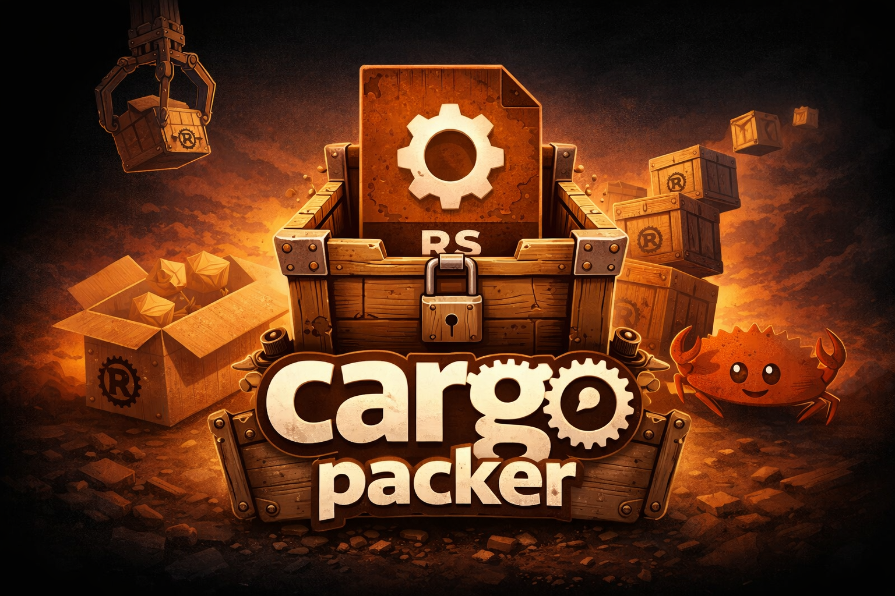

<p align="center">
  
</p>

<p align="center">
  <sub>© 2026 BlancoBAM. Cargo Packer name, logo, and artwork are the property of the project author.</sub>
</p>

---

# Cargo Packer

[](https://addons.mozilla.org/firefox/addon/cargo-packer)
[](https://chrome.google.com/webstore/detail/cargo-packer)
[](https://developer.chrome.com/docs/extensions/mv3/)
[](https://www.rust-lang.org)
[](https://webassembly.org)
[](https://oxichrome.dev)
[](https://leptos.dev)
[](LICENSE)

> **Save crates.io pages to local Cargo.toml files** — A modern, cross-browser extension built with Rust/WASM via Oxichrome. Features live TOML preview, File System Access API export, deduplication, and MV3 compliance.

---

## Overview

Cargo Packer is a **cross-browser (Firefox + Chromium) extension** that lets you collect Rust crate metadata from crates.io and export it directly to a `Cargo.toml` file. Built entirely in **Rust compiled to WebAssembly** using **Oxichrome** and **Leptos**, it delivers native performance with a reactive UI.

| Feature | Description |
|---------|-------------|
| **One-click saving** | Save any crate from crates.io with a single click |
| **Smart deduplication** | Automatic `name@version` deduplication |
| **Live TOML preview** | Real-time Cargo.toml preview with carousel pagination |
| **File System Access API** | Native file picker for export (with downloads fallback) |
| **Multiple formats** | Export as TOML, JSON, or plain text |
| **Permission toggles** | Optional permissions for downloads & scripting with live status |
| **Content script injection** | Auto-injects on crates.io crate pages |
| **Cross-browser MV3** | Native Firefox and Chrome/Chromium support |

---

## Screenshots

<p align="center">
  
  
</p>

---

## Installation

### Firefox (Recommended)

1. Download the latest `cargo-packer-firefox.zip` from [Releases](https://github.com/BlancoBAM/Cargo-Packer/releases)
2. Open Firefox → `about:debugging`
3. Click **This Firefox** → **Load Temporary Add-on**
4. Select the extracted `dist/firefox/manifest.json` or the `.xpi` file

### Chrome / Brave / Edge

1. Download the latest `cargo-packer-chromium.zip` from [Releases](https://github.com/BlancoBAM/Cargo-Packer/releases)
2. Open `chrome://extensions` (or `brave://extensions`)
3. Enable **Developer mode** (top right)
4. Click **Load unpacked** → Select the extracted `dist/chromium/` folder

### From Source

```bash
# Prerequisites
rustup target add wasm32-unknown-unknown
cargo install cargo-oxichrome

# Build
git clone https://github.com/BlancoBAM/Cargo-Packer.git
cd Cargo-Packer
cargo oxichrome build --target chromium --release
cargo oxichrome build --target firefox --release
```

---

## Usage

1. **Navigate** to any crate page on [crates.io](https://crates.io) (e.g., `https://crates.io/crates/serde`)
2. **Click** the Cargo Packer extension icon in your toolbar
3. **Review** the detected crate info (name, version, description, dependencies)
4. **Click** "Save [crate-name]" — deduplication is automatic
5. **Switch tabs** via carousel to see the live `Cargo.toml` preview
6. **Export** via:
   - **File System Access API** — Native "Save As" dialog (modern browsers)
   - **Downloads API** — Falls back to `~/Downloads/Cargo.toml`

---

## Permissions

| Permission | Type | Purpose |
|------------|------|---------|
| `activeTab` | Required | Read crate page DOM on click |
| `storage` | Required | Persist saved crates & settings |
| `host_permissions` | Required (`*://crates.io/*`) | Content script injection on crate pages |
| `downloads` | **Optional** | Fallback export via browser downloads |
| `scripting` | **Optional** | Dynamic content script injection |

> **Optional permissions** can be toggled in the popup's **Permissions** section. Status indicators show granted (🟢) vs not granted (🟠).

---

## Architecture

```
Cargo Packer
├── src/
│   ├── lib.rs          # Oxichrome entry: popup, background, content script
│   └── popup.css       # Reactive UI styles (Leptos + Tailwind-like)
├── icons/              # crgo-pkr-panel-icon variants (16–128px + SVG)
├── dist/
│   ├── chromium/       # Chrome/Brave/Edge MV3 build
│   └── firefox/        # Firefox MV3 build (gecko.id: crates-packer@oxichrome.dev)
└── Cargo.toml          # Rust deps: oxichrome, leptos, serde, chrono, regex, gloo-timers
```

**Key technologies:**
- **Oxichrome 0.2** — Rust → WASM extension framework
- **Leptos 0.8** — Fine-grained reactive UI (signals, effects, memo)
- **wasm-bindgen** — JS/WASM interop
- **serde + chrono** — Serialization & timestamps
- **regex** — DOM parsing in content script

---

## Development

```bash
# Debug build (fast iteration)
cargo oxichrome build --target chromium
cargo oxichrome build --target firefox

# Release build (optimized WASM ~1.5MB)
cargo oxichrome build --target chromium --release
cargo oxichrome build --target firefox --release

# Run wasm-opt manually (if installed)
wasm-opt -Oz dist/chromium/wasm/cargo_packer_v2_bg.wasm -o dist/chromium/wasm/cargo_packer_v2_bg.wasm
```

**Project structure:**
- `#[oxichrome::popup]` — Leptos component mounted in popup.html
- `#[oxichrome::background]` — Service worker (MV3 background.js)
- `init_content_script()` — Injected via `content_scripts` manifest key
- `storage::get/set` — IndexedDB-backed persistence via oxichrome

---

## Roadmap

- [ ] **Crate version selector** — Save specific versions, not just latest
- [ ] **Dependency graph export** — Generate `cargo tree` output
- [ ] **Batch import/export** — JSON backup & restore
- [ ] **crates.io API integration** — Fetch metadata without DOM scraping
- [ ] **Workspace support** — Multi-crate `Cargo.toml` with `[workspace]`
- [ ] **GitHub/GitLab integration** — Save from repo Cargo.toml files
- [ ] **Publish to AMO / Chrome Web Store** — Official distribution

---

## Contributing

1. Fork the repository
2. Create a feature branch: `git checkout -b feature/amazing-feature`
3. Commit changes: `git commit -m 'Add amazing feature'`
4. Push to branch: `git push origin feature/amazing-feature`
5. Open a Pull Request

Please ensure `cargo fmt`, `cargo clippy`, and tests pass before submitting.

---

## License and Branding

© 2026 BlancoBAM. All rights reserved.

The Cargo Packer name, logo, and associated artwork are project identifiers owned by the author. Unauthorized commercial redistribution of the branding assets is not permitted without permission.

The source code is licensed under the **MIT License** — see [LICENSE](LICENSE) for details.

---

<p align="center">
  <sub>Built with ❤️ using <a href="https://oxichrome.dev">Oxichrome</a>, <a href="https://leptos.dev">Leptos</a>, and <a href="https://www.rust-lang.org">Rust</a>.</sub>
</p>